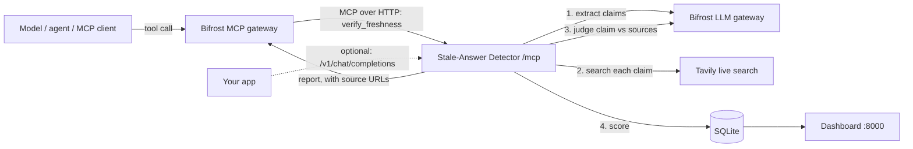

# Stale-Answer Detector for Bifrost

> Catches confident-but-outdated LLM answers (pricing, API versions, laws, leadership) by re-verifying them against the live web, and gives every claim a **freshness score**. Runs as an **MCP server inside Bifrost's MCP gateway**, plus an optional non-blocking proxy.

Built for the Global AI Hackathon 2026 (Problem Statement 04: *Bifrost contributor track*, and Problem Statement 06: *Tavily stale-answer detector*).

| Technology | Role in the solution |
|---|---|
| **Bifrost** (Maxim AI) | (1) Hosts this service as an MCP client, exposing its tools to models and agents through the gateway. (2) Handles every LLM call the detector makes (claim extraction, judging), so routing, fallbacks, budgets and logs apply. |
| **Tavily** | Live web search that supplies fresh evidence for each flagged claim. |

## How it works



**Non-blocking by design.** Verification (several web searches and LLM calls) is slow, so it never runs on the request path:
- `POST /v1/verify` and the proxy queue a FastAPI **BackgroundTask** and return immediately; poll `GET /v1/checks/{id}`.
- The MCP tool waits up to 25 s (below Bifrost's default 30 s tool timeout), then returns `pending` plus a `check_id` for `get_freshness_report`. The check keeps running either way.
- Every Tavily/Bifrost call has its own timeout (`STEP_TIMEOUT`); one slow call turns a single claim into `unverifiable` instead of failing the check.

**Pipeline** (`app/pipeline.py`): extract time-sensitive claims (LLM, regex fallback) -> categorise (`pricing`, `version`, `leadership`, `law`, `statistic`, `event`, `other`) -> Tavily search -> LLM judges `current` / `outdated` / `unverifiable` from that evidence only -> score.

**Scoring** (0-100 per claim): `current` = 50 + 50 x confidence; `outdated` = 50 - 50 x confidence; `unverifiable` = 50; no sources = capped at 30. Answer score = 0.5 x mean + 0.5 x worst claim. Stale = any outdated claim, or score below `STALE_THRESHOLD` (default 40).

## Local setup (beginner-friendly, ~10 minutes)

You need **Python 3.11+**, **Node.js 18+** (to run Bifrost) and two API keys.

### Step 1: Get keys
- **Tavily**: <https://app.tavily.com>, copy your key (starts with `tvly-`).
- **An LLM provider key** (e.g. OpenAI). You give this to Bifrost, not to this project.

### Step 2: Start the detector
In a terminal inside this folder:

**macOS / Linux**
```bash
python3 -m venv .venv && source .venv/bin/activate
pip install -r requirements.txt
cp .env.example .env
```
**Windows (PowerShell)**
```powershell
python -m venv .venv
.venv\Scripts\activate
pip install -r requirements.txt
copy .env.example .env
```
Open `.env` and set `TAVILY_API_KEY=tvly-...`, then:
```bash
uvicorn app.main:create_app --factory --port 8000
```
Open <http://localhost:8000> for the dashboard.

### Step 3: Run Bifrost with the MCP client registered
Bifrost refuses to register **loopback/private-address** HTTP MCP servers through its API unless dashboard auth is enabled, so define the client in `config.json` (always accepted). Create a folder `bifrost-data`, put a `config.json` in it containing the contents of [`bifrost/mcp-client.config.json`](bifrost/mcp-client.config.json) (merge the `mcp` block into your existing config if you have one), then start Bifrost with that app directory:

```bash
npx -y @maximhq/bifrost -app-dir ./bifrost-data
```
Docker alternative: `docker run -p 8080:8080 -v $(pwd)/bifrost-data:/app/data maximhq/bifrost`. If Bifrost runs in Docker and the detector on your host, change `connection_string` to `http://host.docker.internal:8000/mcp`.

Open <http://localhost:8080>, add your LLM provider key (Providers), and check **MCP Gateway**: `stale_detector` should show `healthy` with two tools. (Flags and paths can differ between Bifrost versions; see the Bifrost docs on [connecting to MCP servers](https://docs.getbifrost.ai/mcp/connecting-to-servers).)

### Step 4: Try it
1. Dashboard: paste `The CEO of Twitter is Jack Dorsey.` and click **Verify freshness**; the row shows "checking…" then a score.
2. Through Bifrost (the model can call the tool; tool names are prefixed with the server name, check the exact name in MCP Gateway):
```bash
curl http://localhost:8080/v1/chat/completions -H "Content-Type: application/json" -d '{
  "model": "openai/gpt-4o-mini",
  "messages": [
    {"role": "system", "content": "Before answering with prices, versions, laws or who holds a role, call verify_freshness on your draft and correct anything marked outdated."},
    {"role": "user", "content": "Who is the CEO of Twitter and what does GPT-4 cost per 1K tokens?"}]
}'
```
3. Direct API:
```bash
curl -X POST http://localhost:8000/v1/verify -H "Content-Type: application/json" \
  -d '{"answer": "The CEO of Twitter is Jack Dorsey."}'        # returns {"id": 1, "status": "pending", ...}
curl http://localhost:8000/v1/checks/1
```

### Docker Compose (both services)
```bash
cp .env.example .env     # set TAVILY_API_KEY
mkdir -p bifrost-data && cp bifrost/mcp-client.config.json bifrost-data/config.json
# edit connection_string in bifrost-data/config.json to http://detector:8000/mcp
docker compose up --build
```

### Optional: proxy mode
Point an app at `http://localhost:8000/v1/chat/completions` instead of Bifrost. It forwards to Bifrost, returns the answer immediately, and adds `stale_answer_report: {id, status: "pending"}` and an `X-Check-Id` header; poll `/v1/checks/{id}`. `stream: true` is rejected.

### Troubleshooting
| Problem | Fix |
|---|---|
| Dashboard says `offline` | The detector isn't running; redo Step 2. |
| Claims `unverifiable` with "Live search failed" | `TAVILY_API_KEY` missing or wrong in `.env`; restart after editing. |
| `LLM extraction failed; heuristic fallback used` | Bifrost unreachable or model not configured; check `BIFROST_URL`, `ANALYSIS_MODEL`. |
| HTTP 404 from Bifrost | Your Bifrost may use another chat path; set `BIFROST_CHAT_PATH`. |
| `stale_detector` not `healthy` in Bifrost | Is the detector running on port 8000? In Docker, use `host.docker.internal` or the compose service name. |
| MCP calls time out | Bifrost's default tool timeout is 30 s; keep `wait_seconds` <= 25 or raise `tool_execution_timeout`. |

## Tests
```bash
pip install -r requirements-dev.txt
python -m pytest -v
```
Fakes replace Bifrost and Tavily, so no keys or network are needed.

## Layout
```
app/pipeline.py   claims -> Tavily -> judge -> score (framework-free, per-call timeouts)
app/mcp.py        MCP server (JSON-RPC over HTTP), 2 tools
app/main.py       FastAPI: /mcp, /v1/verify, /v1/checks, proxy, dashboard static mount
app/store.py      SQLite: pending -> done/failed lifecycle + metrics
app/bifrost.py, app/tavily.py   API clients
bifrost/mcp-client.config.json  ready-to-paste Bifrost MCP client entry
```

## Design notes and limitations
- Integrates through Bifrost's **MCP gateway**, a supported extension point. Verification is a tool that models/agents call on demand; it does not automatically intercept every response inside Bifrost. Automatic interception needs a native Go `PostLLMHook` plugin, a natural upstream follow-up (Bifrost Go plugins require a dynamic Bifrost build on Linux/macOS with a matching Go version).
- Background tasks run in-process: they are lost if the service restarts (such rows are marked `failed` on next start). For heavy production load, swap in a queue.
- Verdicts are only as good as the retrieved sources and judging model; treat scores as triage.
- The dashboard and API have no login; the `/mcp` endpoint supports an optional bearer token (`MCP_AUTH_TOKEN`). Keep the service on a private network.

## License
MIT
