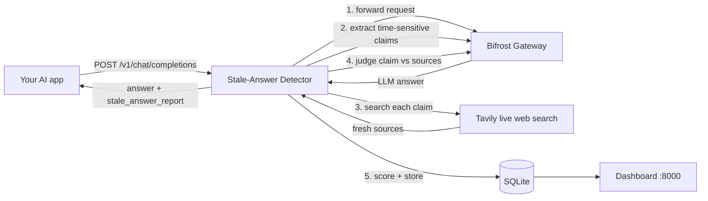

# Stale-Answer Detector for Bifrost

> Catches confident-but-outdated LLM answers (pricing, API versions, laws, leadership) by re-verifying them against the live web, and gives every claim a **freshness score**.

Built for the Global AI Hackathon 2026 (Problem Statement 04: *Bifrost contributor track* and Problem Statement 06: *Tavily stale-answer detector*).

| Technology | Role in the solution |
|---|---|
| **Bifrost** (Maxim AI) | Every LLM call goes through it: the proxied user request, claim extraction, and claim judging. Routing, fallbacks, caching, budgets and logs configured in Bifrost apply automatically. |
| **Tavily** | Live web search that supplies fresh evidence for each flagged claim. |

## How it works



**Pipeline** (`app/pipeline.py`)

1. **Claim identification**: an LLM (via Bifrost) extracts self-contained, time-sensitive claims. If the gateway fails, regex heuristics take over so the system still works.
2. **Freshness detection**: each claim is categorised: `pricing`, `version`, `leadership`, `law`, `statistic`, `event`, `other`.
3. **Live verification**: Tavily retrieves current sources; the LLM judges `current` / `outdated` / `unverifiable` using only that evidence and today's date.
4. **Freshness scoring** (0-100 per claim):
   - `current`: `50 + 50 x confidence`
   - `outdated`: `50 - 50 x confidence`
   - `unverifiable`: `50`
   - no sources found: capped at `30`
   - Answer score = `0.5 x mean + 0.5 x worst claim`. An answer is flagged **stale** if any claim is outdated or the score is below `STALE_THRESHOLD` (default 40).

## Two ways to use it

**A. Drop-in proxy**: point your app at this service instead of Bifrost. The response is unchanged except for an extra `stale_answer_report` field and two headers (`X-Freshness-Score`, `X-Stale-Answer`).

```bash
curl http://localhost:8000/v1/chat/completions -H "Content-Type: application/json" -d '{
  "model": "openai/gpt-4o-mini",
  "messages": [{"role": "user", "content": "Who is the CEO of Twitter and what does GPT-4 cost per 1K tokens?"}]
}'
```

**B. Verify any text**:

```bash
curl http://localhost:8000/v1/verify -H "Content-Type: application/json" \
  -d '{"answer": "The CEO of Twitter is Jack Dorsey."}'
```

Limitation: `stream: true` is rejected (the full answer is needed before verifying).

## Local setup (beginner-friendly, ~10 minutes)

You need: **Python 3.11+**, **Node.js 18+** (to run Bifrost) and two API keys.

### Step 1: Get your keys
- **Tavily**: sign up at <https://app.tavily.com> and copy your key (starts with `tvly-`).
- **An LLM provider key** (for example OpenAI). You give this to Bifrost, not to this project.

### Step 2: Start Bifrost
Open a terminal and run:
```bash
npx -y @maximhq/bifrost
```
Leave it running. Open <http://localhost:8080>, add your provider (for example OpenAI) and paste its API key in the Bifrost UI. (Prefer Docker? `docker run -p 8080:8080 maximhq/bifrost`.)

### Step 3: Get this project running
In a **second** terminal, inside this project's folder:

**macOS / Linux**
```bash
python3 -m venv .venv
source .venv/bin/activate
pip install -r requirements.txt
cp .env.example .env
```

**Windows (PowerShell)**
```powershell
python -m venv .venv
.venv\Scripts\activate
pip install -r requirements.txt
copy .env.example .env
```

### Step 4: Add your Tavily key
Open the `.env` file in any editor and set `TAVILY_API_KEY=tvly-...`. If your Bifrost model name differs, change `ANALYSIS_MODEL` (format `provider/model`).

### Step 5: Start the detector
```bash
uvicorn app.main:create_app --factory --port 8000
```

### Step 6: Use it
Open <http://localhost:8000>, paste `The CEO of Twitter is Jack Dorsey.` and click **Verify freshness**.

### Docker alternative (runs both services)
```bash
cp .env.example .env     # set TAVILY_API_KEY
docker compose up --build
```
Then add your provider key in the Bifrost UI at <http://localhost:8080>.

### Troubleshooting
| Problem | Fix |
|---|---|
| Dashboard says `offline` | The detector isn't running; redo Step 5. |
| Claims show `unverifiable` with "Live search failed" | `TAVILY_API_KEY` is missing or wrong in `.env`. Restart after editing. |
| `LLM extraction failed; heuristic fallback used` | Bifrost isn't reachable or the model isn't configured. Check `http://localhost:8080`, `BIFROST_URL` and `ANALYSIS_MODEL`. |
| HTTP 404 from Bifrost | Your Bifrost version may expose a different path. Check its docs and set `BIFROST_CHAT_PATH` (e.g. `/openai/v1/chat/completions` with a plain model name like `gpt-4o-mini`). |

## Run the tests
```bash
pip install -r requirements-dev.txt
python -m pytest -v
```
Tests use fake LLM/search clients (no keys or network needed) and cover scoring, heuristics, graceful degradation, storage, and the HTTP API including the proxy.

## Project layout
```
app/pipeline.py   claim extraction, verification, scoring (framework-free)
app/bifrost.py    Bifrost client      app/tavily.py   Tavily client
app/store.py      SQLite logs + metrics
app/main.py       FastAPI endpoints   app/static/index.html   dashboard
tests/            unit + API tests    .github/workflows/ci.yml   CI
```

## API
| Endpoint | Purpose |
|---|---|
| `POST /v1/chat/completions` | Verifying proxy in front of Bifrost |
| `POST /v1/verify` | Verify arbitrary text |
| `GET /api/logs`, `GET /api/metrics` | Data behind the dashboard |
| `GET /health` | Status |

## Design notes and limitations
- Integrates with Bifrost through its public OpenAI-compatible HTTP API (a sidecar/proxy), not a compiled Go plugin. This keeps setup to a standard Bifrost install. A native Go `PostHook` plugin that calls this service's `/v1/verify` is a natural upstream follow-up.
- Verdicts are only as good as the retrieved sources and the judging model; treat scores as triage, not ground truth.
- Verification adds latency (one search + LLM call per claim, run concurrently) and cost; use `MAX_CLAIMS` to bound it.
- No authentication on the dashboard/API; do not expose it publicly without a reverse proxy.

## License
MIT
